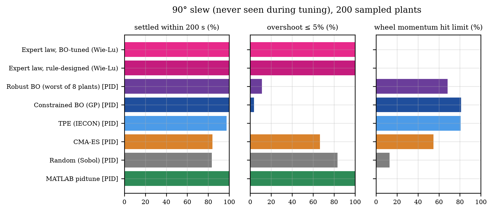

# Constrained Bayesian optimization of CubeSat reaction-wheel attitude control

Simulation study. A 3U-class CubeSat with three reaction wheels must slew 30° and then
hold pointing, under torque (2 mN·m) and momentum (10 mN·m·s) limits, sensor noise,
gyro bias and disturbance torques. Controller parameters are tuned by six optimizers at
equal evaluation budgets and compared with MATLAB `pidtune` and with an expert
large-slew law (Wie & Lu 1995). Tuned designs are then tested on 200 perturbed
spacecraft and on a 90° slew they never saw.

Extends the PID-tuning study in
[iecon-2026-pid-bo-tuning](https://github.com/Baah134/iecon-2026-pid-bo-tuning) to a
spacecraft plant with actuator constraints, equal budgets and robustness testing.

**Results: [RESULTS.md](RESULTS.md).** Design choices: [docs/DECISIONS.md](docs/DECISIONS.md).
Background and derivations: [docs/EXPLAINER.md](docs/EXPLAINER.md).



## What is in here

| Path | Content |
|---|---|
| `src/cubesat/` | Simulator: single-axis (Stage A) and three-axis quaternion rigid body with wheel dynamics, motor lag, momentum clamp (Stage B); PID and Wie-Lu control laws; metrics; spec/constraint problem; plant sampling |
| `src/optim/` | Constrained BO (BoTorch, LogCEI), robust BO, TPE (Optuna, IECON method), CMA-ES, GA (pymoo), Sobol random search, pidtune and rule baselines |
| `scripts/` | Run stages, summarize, robustness Monte Carlo, large-slew test, figures; `pidtune_baseline.m` (MATLAB) |
| `configs/` | Stage configs (budget, seeds, methods, specs) and the pidtune gains |
| `tests/` | 31 physics and plumbing tests (conservation laws, quaternion norm, no unwinding, limits, determinism) |
| `results/` | Every optimizer history (JSON), summaries, tables |

## Reproduce

Python 3.14, Windows or Linux. MATLAB is needed only to regenerate `configs/pidtune_gains.json`.

```bash
python -m venv .venv && .venv/Scripts/pip install -r requirements-lock.txt && .venv/Scripts/pip install -e .
make test        # 31 tests, ~1 min
make figures     # tables and figures from committed histories, ~10 min
make all         # rerun every optimizer x seed, several hours on 12 cores
```
Without `make`: `python reproduce.py test figures` (or `all`).

## Limitations

Simulation only. No attitude estimator, generic disturbances, no momentum dumping,
three orthogonal wheels, offline tuning. See RESULTS.md §7.
